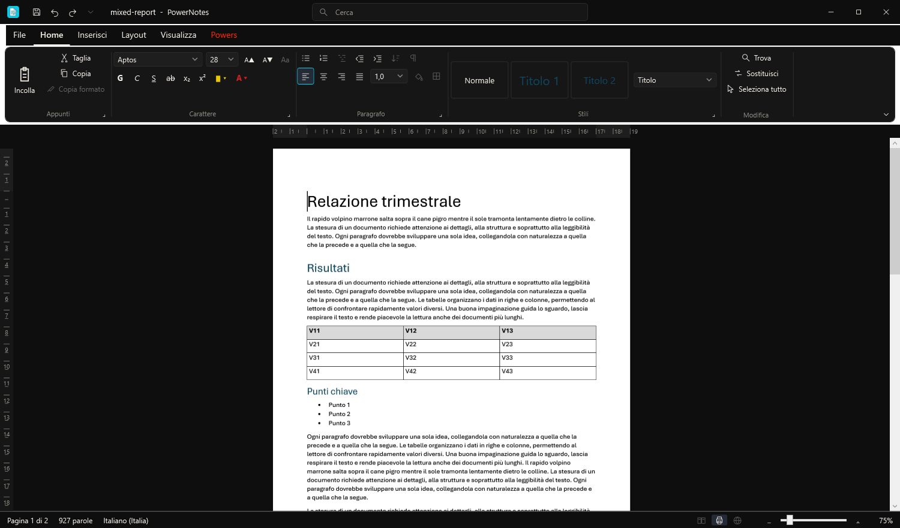
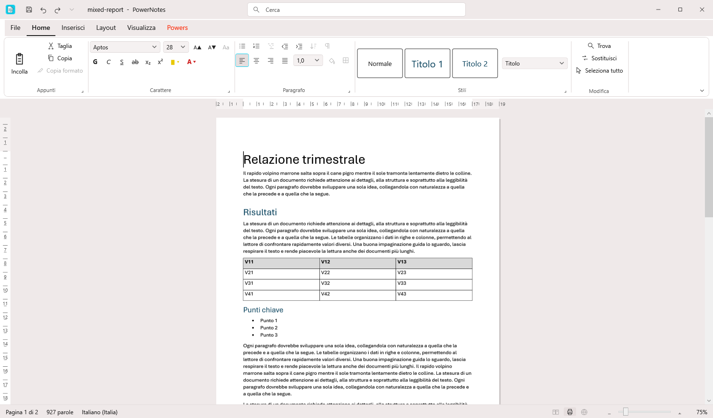
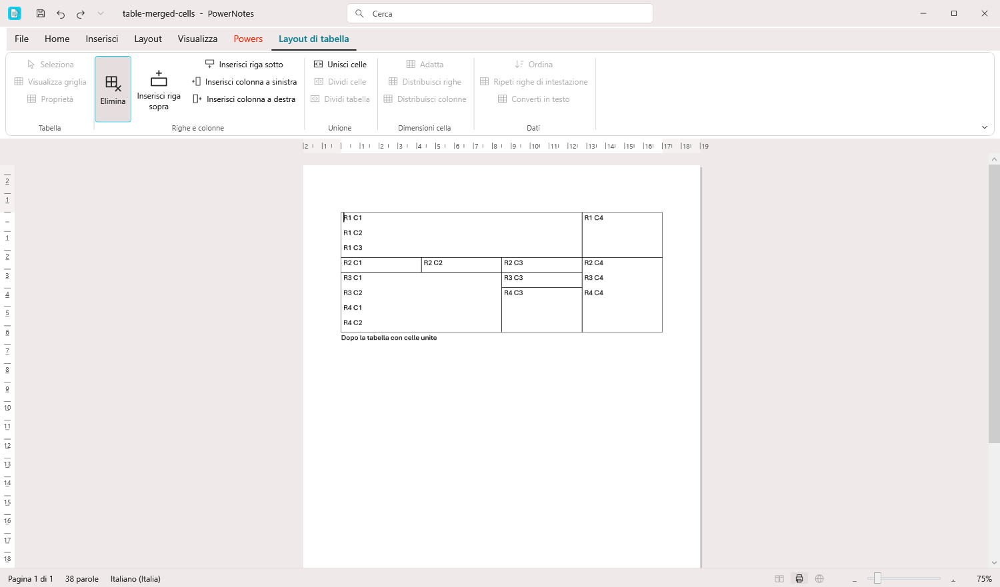
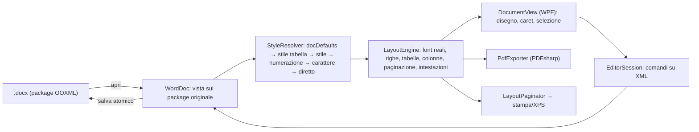

# PowerNotes

Elaboratore di testi per Windows 10/11 x64 che apre e salva **.docx nativo** (OOXML, ECMA-376), con layout di stampa reale. Scritto in C# / .NET 10 / WPF. Licenza MIT.



| Tema chiaro | Contesto tabella |
|---|---|
|  |  |

## Interfaccia
Barra del titolo con salva/annulla/ripeti e casella Cerca (comandi o testo), schede File/Home/Inserisci/Layout/Visualizza/**Powers** più la scheda contestuale Layout di tabella, ribbon a gruppi, righelli in cm, barra di stato con pagina, parole, lingua, viste e zoom. I comandi non ancora implementati sono visibili ma disabilitati ("Non ancora disponibile"). La scheda **Powers** (rosso `#FF2400`) ha l'interruttore *Modalità scura*: tema scuro predefinito, scelta salvata in `%APPDATA%\PowerNotes\settings.json` (file corrotto → valori predefiniti). Icona fornita dall'autore; accento `#0BCCEA` dal suo sfondo.

**Powers** contiene anche due strumenti locali: **Uniforma** (toglie font, dimensione, colore, evidenziazione e sfondo diretti del testo, con anteprima e un solo annulla) e **Scudo privacy** (mostra autore, società, proprietà, autori di commenti e revisioni, percorsi e miniatura; crea una *copia* ripulita, la ricontrolla e dichiara esplicitamente ciò che non sa pulire).

La finestra si adatta alla larghezza: sotto lo spazio disponibile i gruppi del ribbon passano a sole icone, poi in un menu «⋯».

## Cosa fa (P0)
Grassetto, corsivo, sottolineato, barrato, apice/pedice, font, dimensione, colore, evidenziazione; allineamento, interlinea, rientri, spaziatura; stili (Normale, Titolo, Sottotitolo, Titolo 1-3, Citazione…); elenchi puntati e numerati multilivello; tabelle con celle unite (orizzontali e verticali); immagini inline; impostazione pagina, interruzioni di pagina, intestazioni, piè di pagina e numeri di pagina; vista Layout di stampa con paginazione reale, annulla/ripeti, trova e sostituisci; esportazione PDF e stampa. Dettaglio e stato: [FEATURES.md](FEATURES.md). Confronto con Word: [COMPAT.md](COMPAT.md).

## Compilare e avviare
```
dotnet build PowerNotes.sln
src\PowerNotes.App\bin\Debug\net10.0-windows\PowerNotes.exe [file.docx]
dotnet test tests\PowerNotes.Tests                       # tutti i test
dotnet test tests\PowerNotes.Tests --filter "Category!=OfficeCom&Category!=UI"   # senza Word né finestra
```
Requisiti: SDK .NET 10.0.403. I test `OfficeCom` avviano il vero Word (finestra nascosta, kill solo per PID proprio con watchdog); i test `UI` avviano l'app (`PowerNotes.exe --selftest cartella`: eventi di tastiera, testo e click reali sulla superficie e sui pulsanti). Il corpus si rigenera con `tools\make-corpus.ps1`.

## Architettura

- **Round-trip**: il modello è il package aperto; l'editor modifica solo gli elementi toccati; il resto (elementi, attributi, part, relazioni sconosciuti) resta com'è. Salvataggio su file temporaneo + sostituzione.
- **Layout** (`src/PowerNotes.Core/Layout`): metriche lette dai file font (cmap/hmtx/hhea), nessun kerning; stessa pipeline per schermo, PDF e stampa.
- **Editor** (`DocumentView`): superficie custom, non un RichTextBox. Logica di caret/selezione/modifica in `EditorSession` (Core, testabile senza WPF).
- Undo/redo a istantanee XML delle parti modificate.

## Stato (numeri reali, ultima esecuzione)
- Test: 242 superati, 0 falliti, 0 saltati (di cui 90 con Word reale via COM e 2 con l'app reale: autotest e mouse sulla scheda Powers).
- Corpus Word: 37 file, 37/37 salvati dal clone si riaprono in Word senza ripristino con contenuto identico; conta di pagine = Word su 37/37.
- Limiti noti: vedi COMPAT.md. Voci non completate: vedi FEATURES.md (nessuna: finestra Carattere, ingrandisci/riduci, colonne e interruzioni di sezione ora presenti).

Dipendenze: [THIRD_PARTY.md](THIRD_PARTY.md) (PDFsharp bloccato a 6.2.4, le versioni da 6.5 sono AGPL).
